# Expansion Navigator: should Stern Stewart Ventures back Isar Aerospace's expansion?

Team repository from the **SSCO AI Hackathon** (Stern Stewart & Co., Parsdorf, 21–22 October 2026). Team: Benedikt Supper (investor view), Luca Marie Repa (company view), Nils Wagner (technology, tool and data).

In 24 hours we built a decision tool for Stern Stewart Ventures (SSVE) and used it as our final presentation. Every number in the tool comes from a sourced fact warehouse. This README explains the case, our answer and how the repository is organised.

> **Our verdict:** Do not commit on today's evidence. Isar's strategy is right, but even if it works, the launch business makes operating losses until 2037. Reopen diligence at three dated gates.

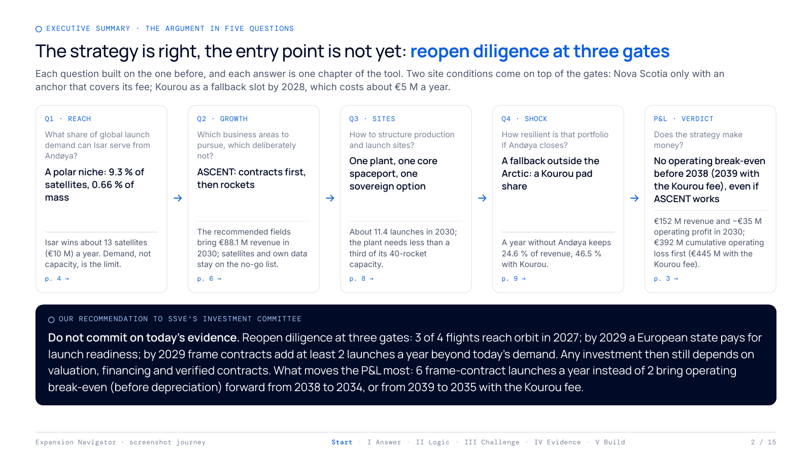

*All images on this page come from our first screenshot journey of the tool. The full deliverable is in [journey/](journey/README.md).*

## Contents

1. [The case](#the-case)
2. [The answer, chapter by chapter](#the-answer-chapter-by-chapter)
3. [How it is built](#how-it-is-built)
4. [Repository map](#repository-map)
5. [Run it](#run-it)
6. [What is not in this repository](#what-is-not-in-this-repository)

## The case

**Isar Aerospace** (Munich) builds the small launcher **Spectrum**: about 1 t to low Earth orbit, 700 kg to sun-synchronous orbit. It reached orbit on its second flight in September 2026, which made Germany the twelfth nation with its own access to space. Its only operational spaceport is **Andøya** in northern Norway. A second site in **Nova Scotia** (Canada) is contracted.

**SSVE** was considering an investment. Its partners Markus Pertl (Managing Partner) and Milan Manduch (AI Partner) wanted two things before meeting Isar's management:

- **Content:** an analysis and a recommendation on which expansion strategy SSVE would back.
- **Decision:** a tool to test site options, challenge management's plan and revisit the case when the situation changes.

The rules were unusual for a consulting case:

- **No PowerPoint, no Excel.** The deliverable was an interactive tool in English, and the tool was the presentation.
- **Valuation was out of scope.** No ticket size, no company value.
- **Judged on argument and build.** Architecture, data basis and robustness counted as much as the storyline.
- **Four questions, handed out one at a time.** Each built on the previous answer.

| # | Question | Time slot | Our short answer |
| --- | --- | --- | --- |
| Q1 | What share of global launch demand can Isar serve from Andøya? | 21.10., 2 h | 9.3 % of satellites but 0.66 % of mass; Isar wins about 13 satellites a year |
| Q2 | Which business areas should Isar pursue, and which deliberately not? | 21.10., 3.5 h, with an expert Q&A | Strategy **ASCENT**: contracts first, then rockets; no satellites, no own constellation |
| Q3 | How should Isar structure its portfolio of production and launch sites? | 22.10., 2.5 h | One plant, one core spaceport, one sovereign option |
| Q4 | How resilient is that portfolio? Shock: Andøya closed, Nova Scotia reserved for Canadian payloads | 22.10., 2 h | Andøya is the single point of failure; a pad share in Kourou lifts surviving revenue from 25 % to 47 % |

The key physical constraint behind all four answers is **the launch site sets the reachable orbits, and the orbits set the customers.** Andøya launches north, so it reaches polar and sun-synchronous orbits (inclination 90–110°) and nothing else. Earth observation lives there, but broadband constellations and geostationary satellites do not. Spaceport contracts lock a launcher in for 15 to 20 years, which makes site choice Isar's least reversible decision.

## The answer, chapter by chapter

The tool has one chapter per question plus explorer chapters for the data. The ▶ Present page condenses everything into one view for the partners.

### The answer page

The headline, the four KPIs and the P&L chart are all computed live from the warehouse for the base case ASCENT. Nothing on this page is typed in by hand.

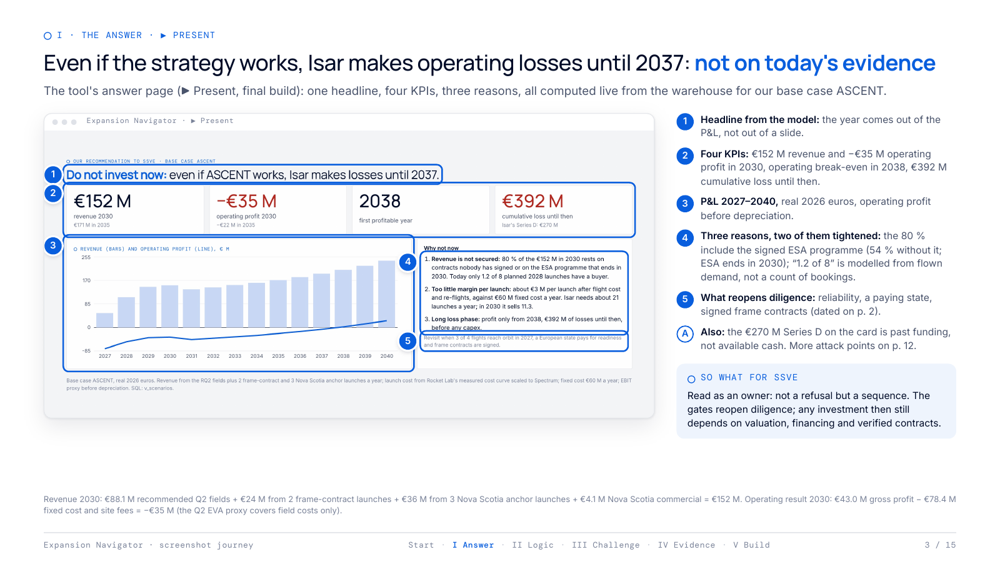

### Q1 · Reach: a polar niche, limited by demand rather than capacity

We counted every satellite launched in 2025 from Jonathan McDowell's GCAT catalogue instead of quoting market reports. That makes the funnel reproducible down to single satellites.

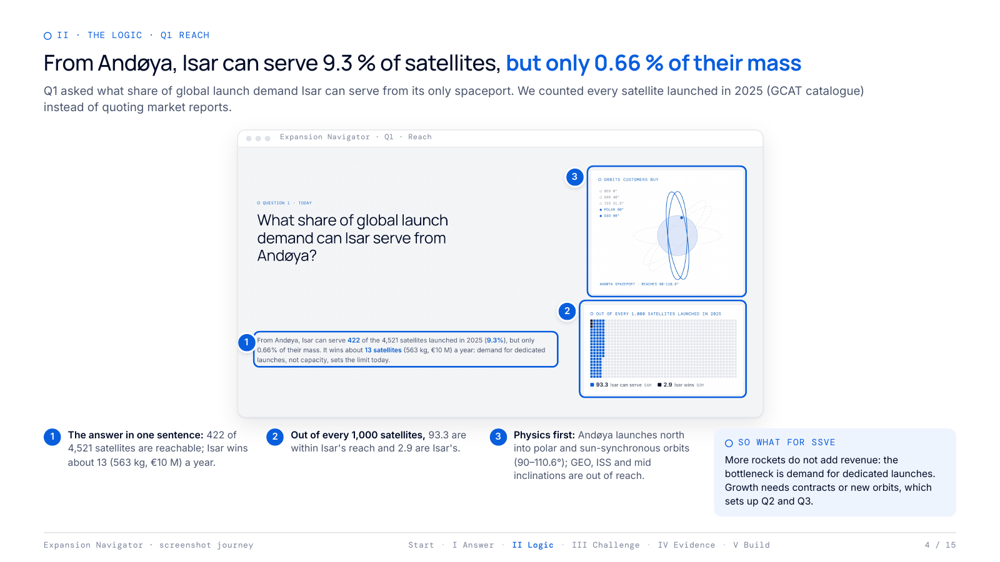

The funnel narrows in three named steps, each tied to a sourced value:

- **TAM:** 4,521 satellites reached orbit in 2025.
- **SAM:** 422 of them are open to Isar, fit on Spectrum and fly in Andøya's orbit band. Starlink, Chinese and Russian payloads and anything too heavy are filtered out.
- **SOM:** 13 of those buy a dedicated small launch (7 %) and choose Isar over Rocket Lab (45 %).

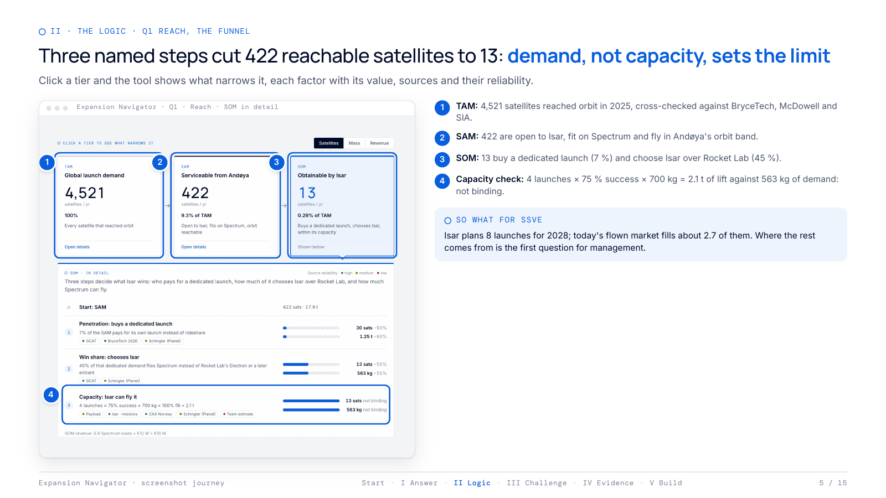

### Q2 · Growth: the ASCENT strategy

Today's flown demand fills about 2.7 of the 8 launches Isar plans for 2028. Growth therefore has to come from contracts, not from rockets on stock. ASCENT names six moves:

- **A**nchor contracts first: frame contracts with deposits before capacity.
- **S**overeign readiness: European states pay for guaranteed launch availability.
- **C**ore polar launches: commercial Earth observation, European institutions and defence.
- **E**xtras on every launch: mission services around the flight.
- **N**o-go list: no satellites, no own constellation, no transfer vehicle, no price war with rideshare.
- **T**riggers for expansion: new sites or fields only once a named trigger is met.

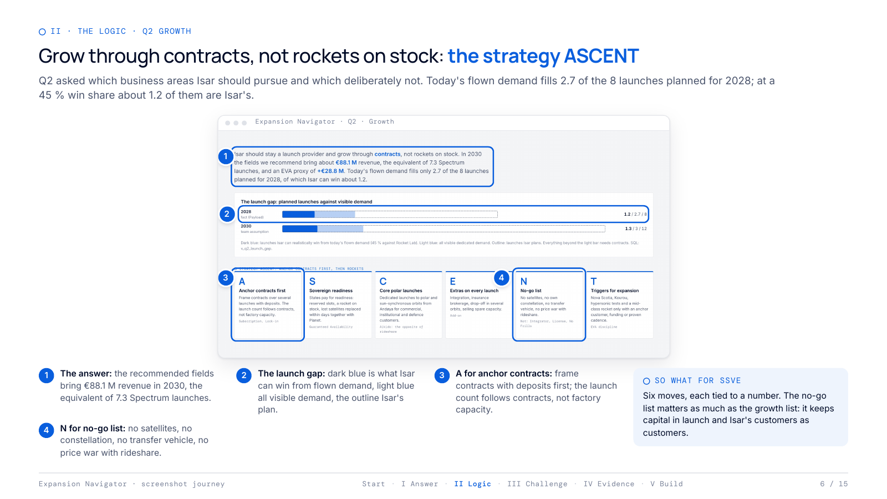

Each of 13 growth fields carries a market size, Isar's share, a margin, fixed cost and tied-up capital. We rank them with an EVA proxy (gross profit minus fixed cost minus 12 % capital charge). The proxy ranks fields; it is not a valuation.

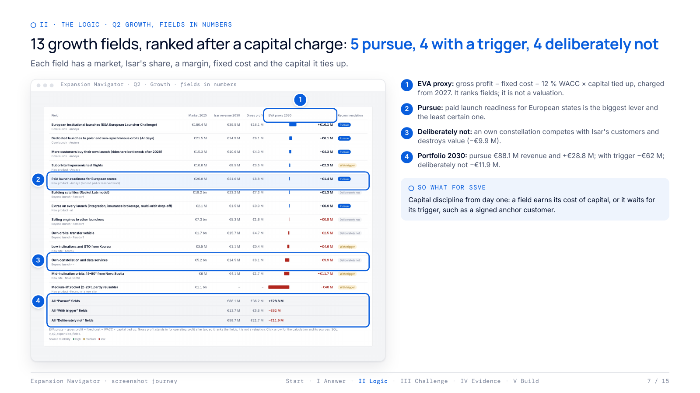

### Q3 · Sites: production is not the constraint

In 2030 Isar needs about 11 launches. The Parsdorf plant is laid out for 40 rockets a year and stays under a third full. Every site therefore has to be justified by orbits, customers and redundancy, never by volume. Nova Scotia only pays off with signed anchor launches that cover its fee.

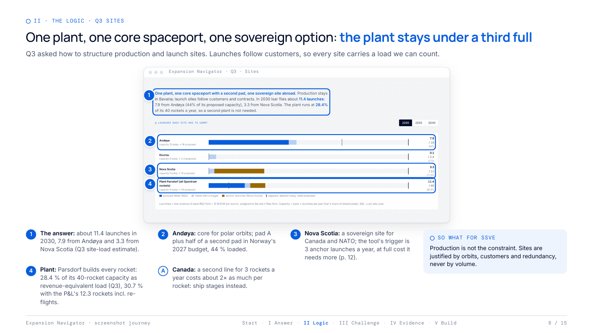

### Q4 · Shock: the launch site is the single point of failure

Q4 closed Andøya and reserved Nova Scotia for Canadian payloads. The plant is not hit, but a year without Andøya keeps only 24.6 % of 2030 revenue. A pad share in Kourou (French Guiana) as insurance keeps 46.5 % and costs about €5 M a year.

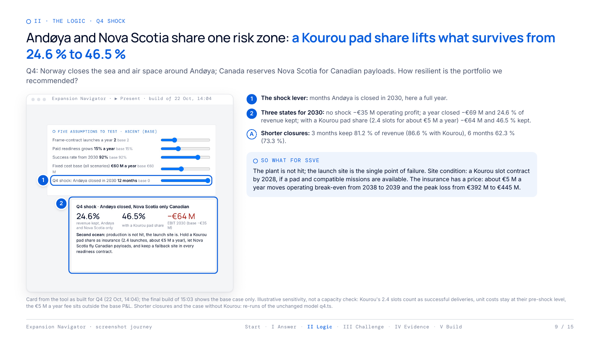

### Challenging the plan: one lever moves the verdict

Partners can move the levers themselves. The strongest one is the number of launches sold under frame contracts. Six instead of two a year pull operating break-even from 2038 to 2034. The question for management becomes "how many signed launches", not "how many rockets".

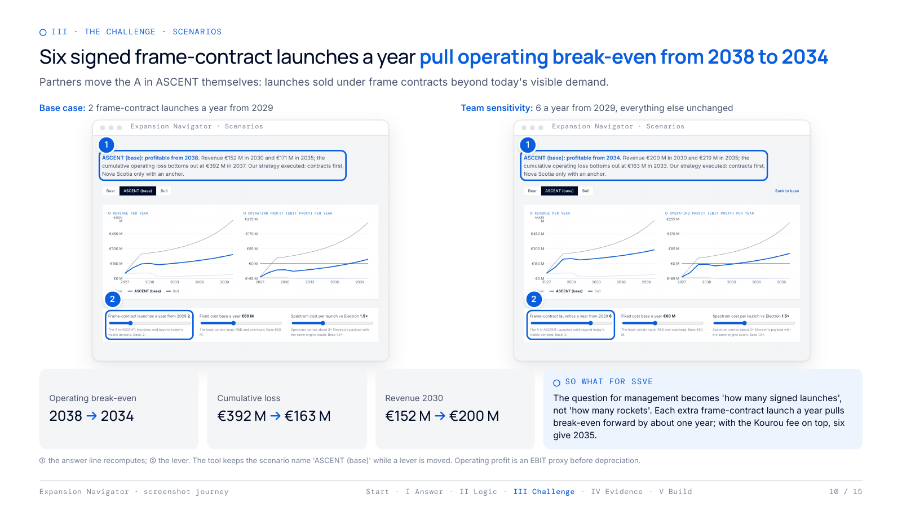

### Every number is traceable

Each lever is bound to one row in the warehouse. That row names the value, the range, the owner, the confidence, the reasoning and its sources. The example below traces the 7 % from the slider to the SQL view to the GCAT catalogue.

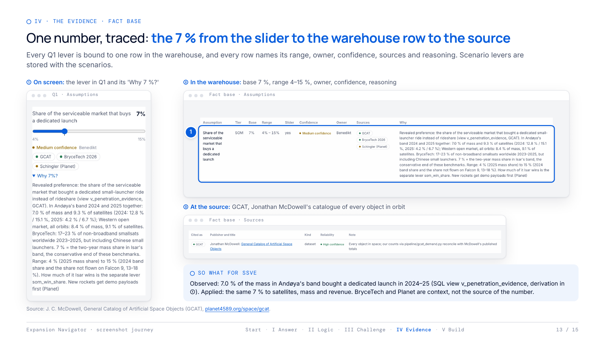

## How it is built

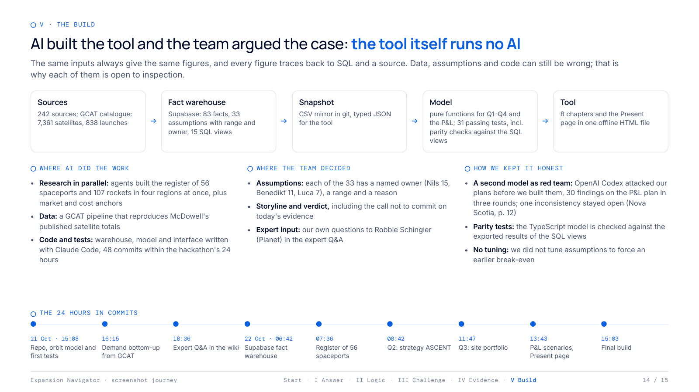

The data flows in one direction, and each step can be inspected:

| Step | What it is | Where |
| --- | --- | --- |
| Sources | 242 sources: market reports, company filings, press, the GCAT catalogue, the expert Q&A | [`database/tables/sources.csv`](database/tables/sources.csv) |
| Fact warehouse | Postgres on Supabase: facts with sources, assumptions with range and owner, spaceport register, satellite and launch catalogues, 15 SQL views | [`warehouse/`](warehouse/README.md), [`database/`](database/README.md) |
| Snapshot | CSV mirror in git plus one typed JSON snapshot for the tool | [`warehouse/seed/`](warehouse/seed), `dashboard/src/data/warehouse.json` |
| Model | Pure TypeScript functions for Q1–Q4 and the P&L, tested for parity against the SQL views | [`dashboard/src/model/`](dashboard/src/model) |
| Tool | Vite, React and TypeScript, built into one offline HTML file | [`dashboard/`](dashboard) |

Three design rules held throughout:

- **No hard-coded numbers in the frontend.** A new spaceport is a new row in `launch_sites`, not new code.
- **Facts and assumptions are separate tables.** What was measured carries a source; what the team judged carries a range, a reason and a named owner.
- **The tool runs no AI.** Claude Code wrote the code, the data pipelines and the research; the shipped tool is deterministic. The same inputs always give the same figures. OpenAI Codex reviewed our plans as a red team before we built them.

## Repository map

| Folder | Content | Start here |
| --- | --- | --- |
| [`database/`](database/README.md) | **Full CSV dump of the database**: all 13 tables and 15 views, plus the schema. Readable without Supabase. | [database/README.md](database/README.md) |
| [`warehouse/`](warehouse/README.md) | Schema, load and export scripts, the CSV mirror `seed/` that the tool is built from, GCAT builders | [warehouse/README.md](warehouse/README.md) |
| [`dashboard/`](dashboard) | The tool: `src/model/` (pure functions with tests), `src/sections/` (one chapter per question plus Spaceports, Rockets, Fact base), `src/present/` (▶ Present), `src/state/levers.ts` (each lever bound to an assumption) | `src/App.tsx` |
| [`pipeline/`](pipeline/README.md) | GCAT classification: customer group, mission and orbit per satellite | [pipeline/README.md](pipeline/README.md) |
| [`wiki/`](wiki/README.md) | Knowledge base in German: company, technology, market, one analysis page per question, assumption register, sources, glossary | [wiki/README.md](wiki/README.md) |
| [`journey/`](journey/README.md) | The screenshot journey requested after the hackathon (29-page PDF) and the pipeline that captures it from the tool | [the PDF](journey/out/SSCO-AI-Hackathon_Isar-Aerospace_Screenshot-Journey_Team-Benedikt-Luca-Nils.pdf) |
| [`progress/`](progress/README.md) | Log of every checkpoint during the hackathon, with what changed and why | [progress/README.md](progress/README.md) |
| [`docs/img/`](docs/img) | Images used in this README | |
| [`scripts/`](scripts) | `checkpoint.sh`: commit, switch to the branch of the current phase, push | |

Branches follow the hackathon phases: `phase/q1-andoya`, `phase/q2`, `phase/q3`, `phase/q4`, `phase/final`. `main` carries the final state.

## Run it

The tool needs only Node:

```bash
cd dashboard && npm install && npm run dev
```

```bash
npm test        # 31 model tests: orbit reach, Q1–Q4, P&L, parity with the SQL views, warehouse integrity
npm run build   # type-check and build dist/index.html, one self-contained file that runs offline
```

Working with the database needs [uv](https://docs.astral.sh/uv/) and a `SUPABASE_DB_URL` in `.env` (not included):

```bash
uv run warehouse/export.py   # Supabase -> warehouse/seed/*.csv and the dashboard snapshot
uv run warehouse/dump.py     # Supabase -> database/ (every table and view as CSV)
uv run warehouse/load.py     # seed CSVs -> Supabase (rebuilds schema and data)
```

Without Supabase, load `database/schema.sql` and the CSVs into any Postgres. The steps are in [database/README.md](database/README.md).

## What is not in this repository

- **Confidential case material.** The participant handouts and our summary of them (`wiki/case/`), the notes from the closed expert Q&A with Robbie Schingler of Planet (`wiki/expert/`) and the meeting transcript (`wiki/transcript/`) stay local. Links to them in the wiki do not resolve here.
- **Credentials.** `.env` holds the database and API keys and was never committed.
- **Personal notes** on the screenshot journey and a superseded first draft of it.

**Please note:** this is a case exercise. All figures are team estimates from public sources and an expert interview, prepared in two days. They are not Isar Aerospace data and not investment advice.
